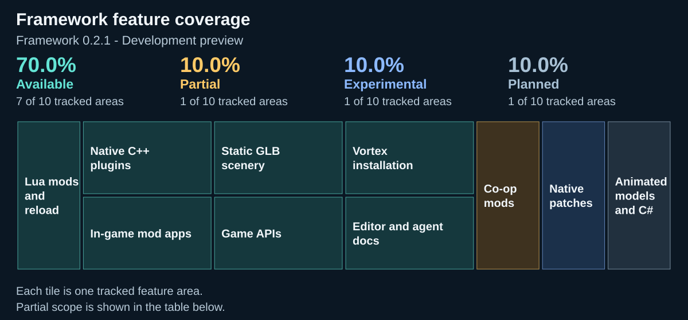
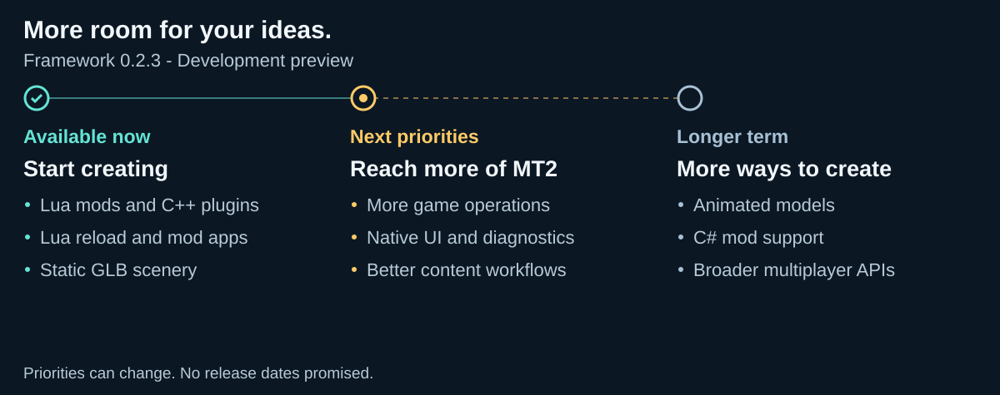

# MT2 Mod Framework

> 🛟 **Need help or found a bug?** Get support at [support.doodesch.de/modframework](https://support.doodesch.de/modframework).


Build mods for **MMORPG Tycoon 2**. Start with Lua and a text editor, extend with C++, or bring your own static GLB scenery into the game.

**[Create your first mod](https://doodesch-mods.github.io/MMORPGTycoon2-ModFramework/quickstart.html)** · [Explore the API](https://doodesch-mods.github.io/MMORPGTycoon2-ModFramework/reference/index.html) · [Use an AI agent](https://doodesch-mods.github.io/MMORPGTycoon2-ModFramework/agents/start.html)

[Feature coverage](#what-can-i-build-today) | [Roadmap](#roadmap) | [Build and contribute](#for-contributors)

<!-- roadmap:start -->
## What can I build today?

Included in [Framework 0.2.6](https://github.com/DooDesch-Mods/MMORPGTycoon2-ModFramework/releases/tag/v0.2.6). Experimental features can change between releases.

<picture>
  <source media="(max-width: 600px)" srcset="https://raw.githubusercontent.com/DooDesch-Mods/MMORPGTycoon2-ModFramework/main/assets/brand/coverage-mobile.svg">
  
</picture>

Percentages count the listed areas equally. They describe feature coverage, not overall project completion or stability.

<details>
<summary>Feature details - what is included</summary>

| Feature | 0.2.6 | What is covered |
| --- | --- | --- |
| Lua mods and reload | ✅ Available | Use a text editor; reload scripts without restarting. A rejected replacement keeps the previous mod running. [Start here](docs/quickstart.md). |
| Native C++ plugins | ✅ Available | Build with the native SDK. Plugin updates require a game restart. [SDK guide](docs/reference/native.md). |
| In-game mod apps | ✅ Available | Open Lua and native mods through the central Mods window, with optional game-desktop icons. Lua apps can use native windows, PNGs and document layouts. [Lua app guide](docs/recipes/lua-apps.md). |
| Static GLB scenery | ✅ Available | Import static models and textures into the scenery catalog. Keep required packs installed for your saves. [Scenery guide](docs/guides/scenery.md). |
| Camera, objects and world actions | ✅ Available | Use the documented camera, time, object and checked world-operation APIs. [API reference](docs/reference/index.md). |
| Native patches | ◇ Experimental | Observe named game calls with ordered callbacks and conflict diagnostics. [Patch guide](docs/experimental/patches.md). |
| Vortex installation | ✅ Available | Manage the player Runtime and mod ZIPs using the separate Vortex Extension. [Install guide](integrations/vortex/README.md). |
| Editor types and agent docs | ✅ Available | Generated Lua types, complete examples and a versioned machine contract. [Agent entry point](docs/agents/start.md). |
| Multiplayer mods | ◐ Partial | Runtime for Multiplayer Early Beta 18, including the native right-click route. Other mods need explicit multiplayer integration; installing the Framework alone does not synchronize them. |
| Animated models and C# | ○ Planned | Future extensions. The current release uses static scenery, Lua and native C++. |

</details>

## Roadmap

<picture>
  <source media="(max-width: 600px)" srcset="https://raw.githubusercontent.com/DooDesch-Mods/MMORPGTycoon2-ModFramework/main/assets/brand/roadmap-mobile.svg">
  
</picture>

[Read the roadmap in text](docs/ROADMAP.md).
<!-- roadmap:end -->

This is a **development preview** for Windows x64 and the verified Steam game build. Multiplayer support must be implemented by each mod. See [compatibility and acceptance](docs/compatibility.md). Players need only the **Runtime** from [Nexus](https://www.nexusmods.com/mmorpgtycoon2/mods/25) or [GitHub Releases](https://github.com/DooDesch-Mods/MMORPGTycoon2-ModFramework/releases). Modders download the separate **MT2Framework-SDK** from GitHub. The SDK includes the runtime, portable helper, full CLI, GLB importer, templates, editor types and offline documentation. Install the separate [Vortex extension](https://www.nexusmods.com/site/mods/2465) to manage runtime and mod ZIPs. [GitHub Actions](https://github.com/DooDesch-Mods/MMORPGTycoon2-ModFramework/actions/workflows/checks.yml) builds and verifies the packages and offline documentation.

The portable helper installs the framework, creates projects and installs mod ZIPs. Lua needs no compiler or Python on an end user's machine. Open **Mods...** from the in-game menu, use **Mods** on the title-screen desktop, or press F10. Select a mod app and choose its **Open** button. Its native window lists installed mods, dependencies and errors, with activation controls and Lua reload. Select a mod to open its settings; developer tools remain available from the same window.


Lua API **1.1.0** adds central mod apps, native game windows, searchable document layouts and richer read-only world dashboards. See the [complete Lua app examples](docs/recipes/lua-apps.md). Native plugin authors can use the same [native windows and previews](docs/experimental/native-document-ui.md). The UI protocol remains experimental.

## For contributors

All required native source dependencies are inside this repository. Build with Visual Studio 2022 C++, CMake and Python:

```powershell
python tools/build.py
python -m unittest discover -s tests -p "test_*.py"
python tools/check_contract.py
npm ci --ignore-scripts
npm run docs:build
```

Generated API reference, editor definitions and machine contracts share [one versioned source](api/contract.json). [CONTRIBUTING.md](CONTRIBUTING.md) explains the checks and generated-file boundaries.

## License

Original framework code, SDK, templates, documentation and branding are [MIT licensed](LICENSE). Modders choose the license for their own original work and retain notices for redistributed template code. Dependencies keep their [original licenses](THIRD_PARTY_NOTICES.md). Game imagery and names retain their respective rights; no game binaries or original archives are included. This is an independent community project, not an official VectorStorm product. The separate multiplayer project keeps its existing license.
