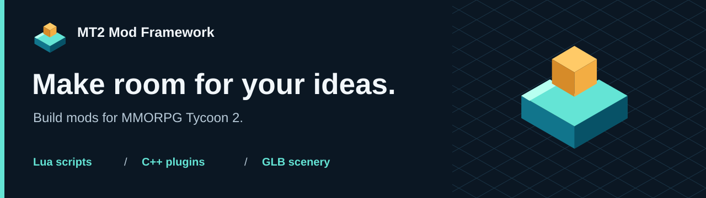
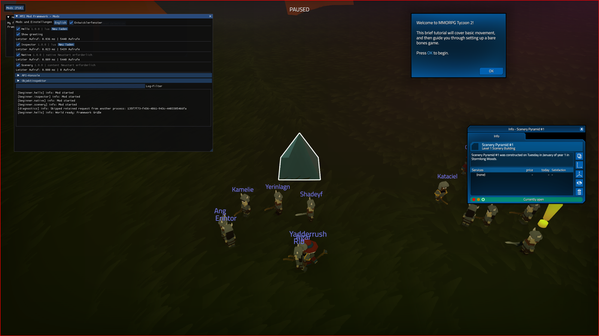

# MT2 Mod Framework

> 🛟 **Need help or found a bug?** Get support at [support.doodesch.de/modframework](https://support.doodesch.de/modframework).



Build mods for **MMORPG Tycoon 2**. Start with Lua and a text editor, extend with C++, or bring your own static GLB scenery into the game.

**[Create your first mod](docs/quickstart.md)** · [Explore the API](docs/reference/index.md) · [Use an AI agent](docs/agents/start.md)



| I want to... | Start here |
| --- | --- |
| Write a visible Lua mod and reload it | [Hello MT2](docs/quickstart.md) |
| Create native C++ plugins | [Native SDK](docs/reference/native.md) and [example](examples/native) |
| Import my own static scenery | [GLB guide](docs/guides/scenery.md) |
| Add settings, shortcuts or world actions | [Recipes](docs/guides/config-storage.md) |
| Manage framework packages with Vortex | [Vortex support and installation](integrations/vortex/README.md) |
| Contribute to the framework | [Build and checks](docs/contributing/build.md) |

This is a **development preview** for Windows x64 and the verified Steam game build. Multiplayer compatibility is not established. See [compatibility and acceptance](docs/compatibility.md). Download the portable framework and separate Vortex extension from [GitHub Releases](https://github.com/DooDesch-Mods/MMORPGTycoon2-ModFramework/releases/tag/v0.1.0). [GitHub Actions](https://github.com/DooDesch-Mods/MMORPGTycoon2-ModFramework/actions/workflows/checks.yml) builds and verifies the packages and offline documentation.

The portable helper installs the framework, creates projects and installs mod ZIPs. Lua needs no compiler or Python on an end user's machine. F10 opens **Mods** in the game.

## For contributors

All required native source dependencies are inside this repository. Build with Visual Studio 2022 C++, CMake and Python:

```powershell
python tools/build.py
python -m unittest discover -s tests -p "test_*.py"
python tools/check_contract.py
npm ci --ignore-scripts
npm run docs:build
```

Generated API reference, editor definitions and machine contracts share [one versioned source](api/contract.json). [CONTRIBUTING.md](CONTRIBUTING.md) explains the checks and generated-file boundaries.

## License

Original framework code, SDK, templates, documentation and branding are [MIT licensed](LICENSE). Modders choose the license for their own original work and retain notices for redistributed template code. Dependencies keep their [original licenses](THIRD_PARTY_NOTICES.md). Game imagery and names retain their respective rights; no game binaries or original archives are included. This is an independent community project, not an official VectorStorm product. The separate multiplayer project keeps its existing license.
