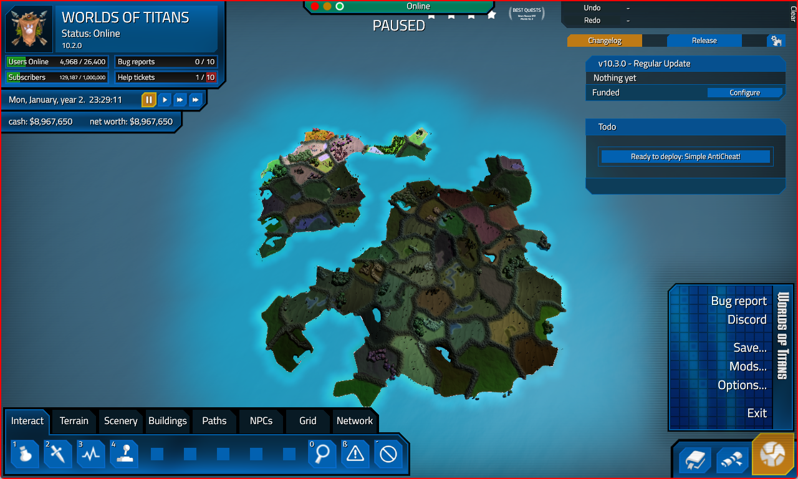
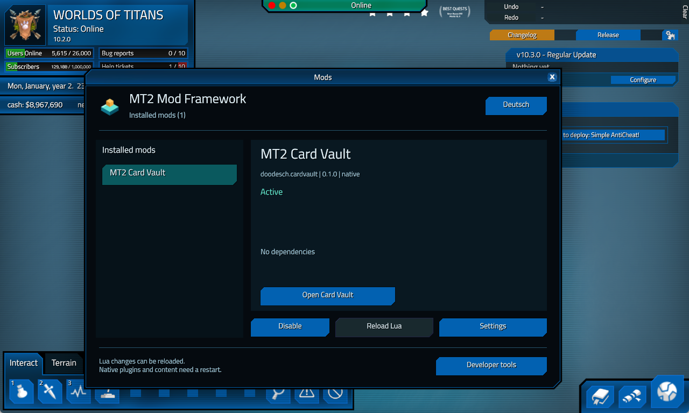

# Native document UI (experimental)

Framework 0.1.4 adds a central app launcher, native game windows and an optional document renderer to the native host JSON interface. These experimental operations are separate from stable Lua API 1.0.0. The C ABI stays at version 1. The [machine contract](../public/api/experimental/native-document-ui.json) defines the accepted fields and limits.

Call these operations from a `render` callback with the `ui` capability. The host supplies the calling mod's identity. Never supply another mod's identity. Networking and PNG decoding belong in a worker, not in the render callback.

## Central entry and native windows

The in-game bottom-right start menu contains **Mods...** before **Options...**. It opens the same native Mods window as the desktop icon and optional framework F10 shortcut. Mods do not need separate function keys.

Call `ui.app` every render callback, including while your app is closed:

```json
{"id":"main","title":"My mod"}
```

This registers one app for the calling active mod instance. The selected mod receives an **Open My mod** button. The response `{"open_requested":true}` consumes that app's launch request. It is never sent to another mod. A replacement instance registers again; inactive instances cannot launch. Keep the app ID and title stable.

Call `ui.native` while open to display an actual game-owned window:

```json
{
  "id":"main","open":true,"width":600,"height":400,
  "widgets":[
    {"id":"search","type":"input","x":20,"y":24,"width":400,"height":34,"value":""},
    {"id":"import","type":"button","x":20,"y":80,"width":180,"height":34,"text":"Import card"}
  ]
}
```

The response contains `ready`, `open`, `clicked` and `values`. Wait if `ready` is false during a mode transition. Store input changes from `values`, process `clicked` once, and stop submitting after the user closes the window. To reopen, wait for the next launcher request. The native close button, window placement, text fields, button activation and Escape handling belong to MT2. Framework management temporarily hides the app window and restores it when closed.

Native `input` widgets accept `max_bytes`, an integer from 1 to 1024 with default 128. Chat can declare `"max_bytes":240`. This field is part of the immutable window layout, so changing it requires a new native mod instance. Scripted values and diagnostic text must fit the same UTF-8 byte limit. Native editing clips only at complete UTF-8 boundaries and confirms the pane's readback; it does not split a multibyte character. Diagnostic setters return byte count and matching-readback acknowledgement without logging the text. This limit is separate from the document renderer's input budget below.

`open` preserves the existing desired/open state while Framework management suspends the app. `visible` reports the actual native window visibility flag, with `visibility_known` true after readback. It is null if the current native window is unavailable. `suspended` reports the Framework management state and is null while the mode is unavailable. A native visible flag does not prove focus, window order or unobscured rendered pixels. Retain actual action acknowledgement and screenshots for those claims.

The window uses native MT2 blue panel materials. Buttons support style button (primary action), tab, row and quiet. Panels use tone subtle for recessed content and preview for the main reading area. Text supports muted and error tones. These are bounded native styles, not arbitrary resource paths.

Layout is fixed for a mod instance; changes to positions, widget types, sizes or IDs require a restart. Change text, values, visibility, disabled and selected states without rebuilding the layout. All widgets stay inside the window. The machine contract lists supported fields and budgets. No filesystem read or layout-file write occurs on unchanged frames.

Native images use immutable original PNG files in the mod-owned `cache/<sha256>.png` directory. The host checks the filename hash, PNG signature, dimensions and size, then creates a namespaced material. Previews are limited to 1 MiB, 2048 pixels per dimension and 128 unique images per session. Game-owned materials remain loaded for the session. Keep card transfer and image decoding outside render callbacks. The existing document renderer below remains available for developer tools.

## Documents

Submit a complete document each frame. Keep document and widget IDs stable. Containers scope their child IDs. The renderer owns the window, styles and balanced ImGui scopes, including error paths.

```json
{
  "document": {
    "id": "browser",
    "title": "My card browser",
    "width": 1120,
    "height": 660,
    "content": {
      "type": "panel",
      "id": "main",
      "children": [
        {"type": "text", "text": "Community cards", "tone": "heading"},
        {"type": "input", "id": "search", "hint": "Search names...", "value": ""},
        {"type": "button", "id": "import", "text": "Import card", "primary": true}
      ]
    }
  }
}
```

The result is `{"clicked": ["import"], "values": {"search": "Dragon"}, "open": true}`. `clicked` and `values` contain only changes in this frame. Store input values in the mod. Stop submitting a document when `open` becomes false. Escape closes the focused document.

| Widget | Fields |
| --- | --- |
| `text` | `text`, optional `tone`: `heading`, `muted`, `success`, `error` |
| `button` | `id`, `text`, optional `primary`, `selected`, `disabled`, `width` |
| `input` | `id`, `value`, `hint`, optional `disabled`; maximum 256 UTF-8 bytes |
| `selectable` | `id`, `title`, `subtitle`, optional `selected`, `disabled` |
| `image` | `image` cache ID, optional maximum `width`, `height`; aspect ratio preserved |
| `panel` | `id`, `children`, optional `height` for a scrollable region |
| `columns` | `children`; child `width` fixes a column, zero uses remaining space |
| `separator` | No extra fields |
| `space` | Optional `height` |

Limits: 200 widgets, depth 8, four columns per container, 2048 bytes per widget string and 4096 pixels per widget dimension. Invalid definitions return a host error before rendering begins. Window title and identity are limited to 128 bytes. Document windows initially fit the game viewport and can be resized.

## Images

Write an immutable preview file under the calling mod's own `data/<mod-id>/` directory. Its binary format is the eight bytes `M2RGBA1\0`, little-endian unsigned 32-bit width and height, then tightly packed RGBA8 pixels. Dimensions must be 1-2048 pixels, with exactly `16 + width * height * 4` bytes. Keep the original PNG separate and unchanged.

Call `ui.image.load` with `{"id": "<content-hash>", "path": "cache/<content-hash>.rgba"}`. Paths must be relative to this mod's data directory. Parent traversal, absolute paths and reparse points are rejected. A confirmed result is `{"id": "<content-hash>", "ready": true}`. This first call reads and uploads the bounded file. Repeated calls with the same ID reuse the texture. Use a new content hash when pixels change.

Each mod retains up to 16 textures. Least recently used textures are evicted. Inactive owners and textures unused for 1800 render frames are collected on the render thread. Texture upload restores the game's previous OpenGL unpack and texture bindings.

Keyboard events captured by a document stay in the framework. Text entry suppresses letter hotkeys while function-key bindings remain available. This is shared framework behavior, so other native mods can reuse it.

## Open apps in the game




